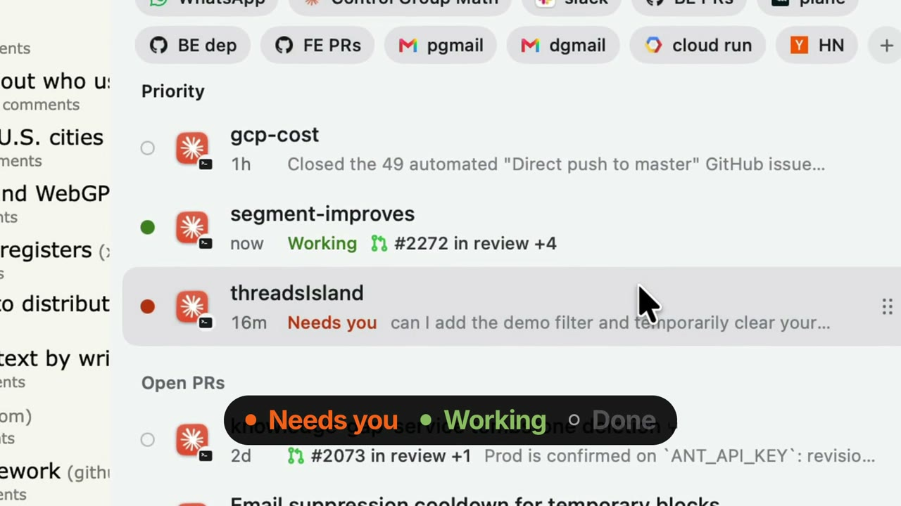

# Heimdall

A Dynamic Island for your coding agents. Heimdall sits in the MacBook notch and lists your
**Codex** and **Claude Code** threads in one place. Click one to jump straight to it.

[](media/heimdall.mp4)

## What it does

- **Threads.** Hover the notch to see every thread from the last 7 days, in sections that never reshuffle.
  An orange lamp means it needs you, green means it's working. The collapsed pill counts both.
  - **Priority:** threads active in the last 2 hours. Drag the grip on the right to reorder them.
  - **Open PRs:** idle threads whose PR is still open, with its status.
  - **Today, Yesterday, weekdays:** the rest, by when you last sent a message.
- **Jump.** Click a thread to go to it: the Codex or Claude app, or the exact Ghostty window or Warp tab
  it's running in. If it isn't open anywhere, it resumes in a new terminal session.
- **Pages.** Press **+** to save where you are: the exact Arc tab, or any other app. Saved pages
  show as chips above your threads, one click away. Swipe with two fingers to switch to the Pages view
  to reorder or remove them.
- **Health.** If an app update breaks a source, a red line says which one, so the list never shrinks
  silently.

Nothing moves unless you hover. Right-click the island for Appearance or Quit.

## Install

Needs macOS 14+, Xcode Command Line Tools (`xcode-select --install`) and the system Python 3.

```sh
git clone https://github.com/ishwar00/heimdall.git ~/.local/share/heimdall
~/.local/share/heimdall/build.sh
open ~/Applications/Heimdall.app
```

Allow the macOS prompts to control Ghostty and Arc the first time you use them. To start at login, add
`~/Applications/Heimdall.app` in System Settings → General → Login Items.

Recommended: install the hooks so Claude Code and Codex report when a turn starts, ends or waits for
approval. Without them, a Codex thread waiting on a command approval shows as working.

```sh
~/.local/share/heimdall/hooks/install    # --remove to undo
```

This adds one command to `~/.claude/settings.json` and `~/.codex/hooks.json`. Your own hooks stay, and
each file is backed up first. Codex asks once to review new hooks: allow them and restart Codex. The hook
records only the event, session, turn and time, never message text.

## Where threads come from

| Source | Read from | Click |
|---|---|---|
| Codex app | `~/.codex/state_*.sqlite` + rollout files | `codex://threads/<id>` |
| Codex CLI | same | its Ghostty window or Warp tab, else `codex resume <id>` |
| Claude desktop (Code tab) | `~/Library/Application Support/Claude/claude-code-sessions` | `claude://code/continue?session=<id>` |
| Claude Code background jobs | `~/.claude/jobs/*/state.json` + `~/.claude/sessions` | its Ghostty window or Warp tab, else `claude attach <id>` |
| Claude Code CLI | `~/.claude/sessions` | its Ghostty window or Warp tab |

## How it works

`bin/heimdall` (Python, standard library only) gathers every source into one JSON list, and
`heimdall --jump` opens a row. The Swift app in `app/` is only the UI. It runs `heimdall` every 32 s
(every 4 s while open). Run `heimdall` yourself to see the raw data. Each click is logged to
`~/Library/Application Support/Heimdall/jumps.log`.

Tests run on a synthetic home folder, with no network and nothing read from your real one:

```sh
/usr/bin/python3 -m unittest discover tests
```

## Limits

- Codex and Claude Code don't publish these file formats. An update can break a source; the health line
  tells you when.
- PR status comes from `gh` (`gh auth login` once), refreshed at most every 5 minutes.
- Jumping to a live session works only in Ghostty and Warp. Sessions in other terminals are listed but
  can't be jumped to.
- Arc can't be told to raise a window, so a saved tab in a background Arc window is selected there
  without coming forward.

## License

[MIT](LICENSE)
